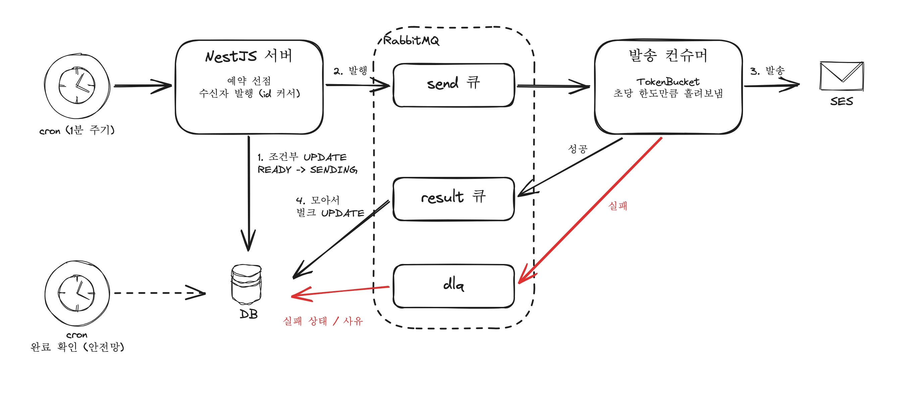

## 발단

예약해둔 대량 메일을 보내는 기능을 NestJS 서버 하나로 새로 만들었다
기존에는 예약 관리/실제 발송/결과 수집이 서로 다른 곳에 나뉘어 있었고 발송은 서버리스 함수를 여러개 띄워서 나눠 보내는 방식이었다

새로 만들면서 풀어야 했던 문제는 세가지였다
1. 서버가 여러대여도 <mark class="hltr-cyan">같은 예약을 한번만</mark> 보내기
2. SES의 초당 발송 한도를 넘지 않게 속도 맞추기
3. 수신자마다 결과를 DB에 반영하되 그게 DB를 두드리지 않게 하기

---

## 왜 자동 확장이 아니라 큐 + 속도 제한인가

서버리스 함수의 장점은 일이 많으면 알아서 늘어나는 것인데 대량 메일에서는 이게 별 의미가 없었다

발송 속도의 상한은 우리 쪽이 아니라 <mark class="hltr-cyan">SES 계정의 초당 발송 한도</mark>가 정하기때문
함수를 100개 띄워도 SES가 받아주는 속도는 그대로고 한도를 넘긴 요청은 스로틀링 에러로 돌아온다
그래서 일꾼을 늘리는것보다 일꾼 수는 고정하고 한도에 맞춰 일정하게 흘려보내는 쪽이 맞다고 판단했다

구조는 이렇게 잡았다
- 예약 트리거 : 1분 주기 cron
- 발송 파이프라인 : RabbitMQ 큐 세개 (send / result / dlq)
- 속도 제어 : 프로세스 안의 TokenBucket
- 결과 반영 : 모아서 벌크 UPDATE



---

## 큐를 세개로 나눈 이유

- send
	- 수신자 한명분 발송 요청이 들어가고 rate limit 걸고 한건씩 SES 호출
- result
	- 발송 성공 결과(SES message id)가 들어가고 모아서 벌크 UPDATE
- dlq
	- 발송 실패 결과가 들어가고 실패 상태와 사유 기록

발송과 결과 반영은 속도가 다른 일이다
발송은 SES 한도에 묶여서 천천히 일정하게 가야하고 결과 반영은 DB에 한번에 몰아서 쓰는게 좋다
한 컨슈머에서 둘다 하면 SES 호출마다 DB UPDATE가 한번씩 따라붙기때문에 큐를 나눠서 각자 자기 속도로 소비하게 했다
실패도 따로 큐가 있으니 성공 경로랑 섞이지 않는다

---

## 1. 같은 예약을 한번만: 조건부 UPDATE + affected rows

cron은 서버마다 돌아서 서버가 두대면 같은 시각에 두 서버가 같은 예약을 동시에 발견한다
이걸 별도 락 없이 막으려고 <mark class="hltr-cyan">상태 전이 자체를 조건부 UPDATE로</mark> 해주었다

```typescript
// 예시 코드
async claim(scheduleId: number): Promise<boolean> {
  const result = await this.scheduleRepo
    .createQueryBuilder()
    .update()
    .set({ status: 'SENDING', startedAt: () => 'NOW()' })
    .where('id = :id AND status = :status', { id: scheduleId, status: 'READY' })
    .execute();

  return result.affected === 1; // 0이면 다른 서버가 먼저 가져갔다
}
```

### 그럼 왜 이게 안전할까?

두 서버가 거의 동시에 이 UPDATE를 날리면 InnoDB에서는 이렇게 된다

| 시점 | 서버 A | 서버 B |
|---|---|---|
| 1 | 행에 쓰기 락, `status = READY` 확인, SENDING으로 변경 | |
| 2 | | 같은 행 락 대기 |
| 3 | 커밋, 락 해제 | |
| 4 | | 락 획득, 최신 값으로 WHERE 다시 평가 -> 이미 SENDING이라 0건 |

UPDATE가 WHERE를 평가할때는 트랜잭션 시작 시점의 스냅샷이 아니라 <mark class="hltr-cyan">가장 최근에 커밋된 값</mark>을 읽는다고 한다(current read)
그래서 "읽고 -> 확인하고 -> 쓰기"가 문장 하나 안에서 원자적으로 일어나고 늦게 온 서버는 반드시 0건을 받는다

반대로 SELECT로 상태를 먼저 읽고 애플리케이션에서 확인한 다음 UPDATE 하면 이게 깨진다. 두 서버가 둘다 READY를 읽고 둘다 보내버림

affected rows도 한번 확인해봤는데 MySQL은 클라이언트가 연결할때 거는 플래그(CLIENT_FOUND_ROWS)에 따라 "조건에 맞은 행 수"를 줄수도 있고 "실제로 값이 바뀐 행 수"를 줄수도 있다
값이 그대로인 행을 UPDATE하면 두 숫자가 달라지는데 위처럼 바꿀 값(SENDING)과 다른 상태(READY)를 WHERE에 걸어두면 둘이 항상 같아서 어느 쪽이든 안전하다

다른 방법도 생각해봤는데
- `SELECT ... FOR UPDATE` : 효과는 같지만 트랜잭션 경계를 직접 챙겨야함
- Redis 분산 락 : 락 만료나 해제 실패 같은걸 따로 신경써야함
- 조건부 UPDATE : 상태 컬럼이 이미 있으면 추가 인프라 없이 문장 하나로 끝

이라서 조건부 UPDATE로 갔다

### 발행은 OFFSET 말고 커서로

예약을 가져간 서버는 아직 PENDING인 수신자 로그를 1000건씩 읽어서 send 큐에 넣는다. 이때 OFFSET 페이징이 아니라 id 커서로 넘겼다

```sql
-- 예시 코드
SELECT id, email FROM send_log
 WHERE schedule_id = :scheduleId AND status = 'PENDING' AND id > :lastId
 ORDER BY id
 LIMIT 1000;
```

발행하는 동안에도 컨슈머가 앞쪽 로그를 PENDING -> SENT로 바꾸고 있어서
`WHERE status = 'PENDING' ... OFFSET 1000`으로 넘기면 앞 페이지 행이 조건에서 빠지면서 결과가 당겨지고 <mark class="hltr-cyan">건너뛰는 행이 생긴다</mark>
id 커서는 "마지막으로 본 id 다음"부터라 중간에 상태가 바뀌어도 밀리지 않는다(뒤로 갈수록 앞 행을 다 읽고 버리는 OFFSET 비용도 없음)

---

## 2. TokenBucket으로 초당 발송량 맞추기

토큰 버킷은 이렇게 생각하면 된다
- 버킷에 토큰이 최대 N개 들어간다 (순간적으로 몰아서 보낼 수 있는 양)
- 초당 R개씩 토큰이 다시 찬다 (평균 속도)
- 보내기 전에 토큰 1개를 꺼내고 없으면 찰때까지 기다린다

평균은 초당 R건을 넘지 않고 잠깐 쉬었다가 다시 보낼때는 N건까지 바로 나간다

```typescript
// 예시 코드
export class TokenBucket {
  private tokens: number;
  private lastRefill = Date.now();
  private readonly waiters: Array<() => void> = [];
  private timer: NodeJS.Timeout | null = null;

  constructor(private readonly capacity: number, private readonly refillPerSec: number) {
    this.tokens = capacity;
  }

  async acquire(): Promise<void> {
    this.refill();
    if (this.tokens >= 1) {
      this.tokens -= 1;
      return;
    }
    return new Promise((resolve) => {
      this.waiters.push(resolve);
      this.scheduleDrain();
    });
  }

  // 타이머로 계속 채우지 않고, 꺼낼때 지난 시간만큼 한번에 채운다
  private refill(): void {
    const now = Date.now();
    const elapsedSec = (now - this.lastRefill) / 1000;
    this.tokens = Math.min(this.capacity, this.tokens + elapsedSec * this.refillPerSec);
    this.lastRefill = now;
  }

  // 토큰 1개가 찰 만큼만 기다렸다가 대기열을 깨운다. 타이머는 하나만
  private scheduleDrain(): void {
    if (this.timer) return;
    const waitMs = Math.ceil(((1 - this.tokens) * 1000) / this.refillPerSec);
    this.timer = setTimeout(() => {
      this.timer = null;
      this.refill();
      while (this.waiters.length > 0 && this.tokens >= 1) {
        this.tokens -= 1;
        this.waiters.shift()!();
      }
      if (this.waiters.length > 0) this.scheduleDrain();
    }, waitMs);
  }
}
```

토큰을 setInterval로 계속 채우지 않고 `acquire` 할때 지난 시간만큼 계산해서 채우게 했다(lazy refill). 아무도 안 보낼때는 돌아가는 타이머가 없다
기다리는 쪽이 많아도 타이머는 하나만 둔다. 요청마다 setTimeout을 걸면 대기자가 수천개일때 타이머도 수천개가 되기때문
send 컨슈머에서는 SES 호출 직전에 `await bucket.acquire()` 한줄이면 된다

>[!버킷은 프로세스 메모리에 있다]
>
>이 버킷은 서버 한대 안에서만 유효하다. send 큐를 여러 서버가 같이 소비하면 전체 발송 속도는 `서버 수 x R`이 된다
>R을 계정 한도에서 소비하는 서버 수로 나눠서 잡거나 서버끼리 정확히 공유해야 하면 Redis 같은 공용 저장소에 버킷을 둬야한다
>

---

## 3. 결과는 모아서 한번에: 벌크 UPDATE

성공 결과마다 UPDATE를 한번씩 하면 수신자 수만큼 쿼리가 나간다
그래서 result 컨슈머는 결과를 버퍼에 모았다가 <mark class="hltr-cyan">1000건이 차거나 5초가 지나면</mark> 한번에 반영하게 했다

수신자마다 SES message id가 다르니 `UPDATE ... WHERE id IN (...)` 하나로는 안되고 `CASE`로 행마다 다른 값을 넣었다

```typescript
// 예시 코드
private async flush(): Promise<void> {
  if (this.buffer.length === 0 || this.flushing) return;
  this.flushing = true;
  const batch = this.buffer.splice(0);

  try {
    const params: unknown[] = [];
    const cases = batch
      .map((b) => {
        params.push(b.logId, b.sesMessageId);
        return 'WHEN ? THEN ?';
      })
      .join(' ');

    await this.dataSource.query(
      `UPDATE send_log
          SET ses_message_id = CASE id ${cases} END,
              status = 'SENT',
              sent_at = NOW()
        WHERE id IN (?) AND status = 'PENDING'`,
      [...params, batch.map((b) => b.logId)],
    );

    batch.forEach(({ msg }) => this.channel.ack(msg)); // DB 반영이 끝난 다음에 ack
  } catch (e) {
    this.buffer.unshift(...batch); // 다음 flush에서 다시
  } finally {
    this.flushing = false;
  }
}
```

여기서 챙긴 것들

**ack는 DB 반영이 끝난 다음에**

버퍼에 넣는 시점에 ack 하면 flush 전에 서버가 죽었을때 결과가 그대로 사라진다. 반영이 끝난 다음에 ack 해야 죽더라도 브로커가 다시 보내준다
flush가 실패하면 배치를 버퍼 앞에 다시 넣는다. 아직 ack를 안했으니 브로커 입장에서도 처리중 상태 그대로다

**`status = 'PENDING'` 조건**

같은 메시지가 재전달돼서 두번 오더라도 이미 SENT인 행은 다시 건드리지 않게 걸어두었다

**prefetch는 버퍼보다 크게**

수동 ack 모드에서 컨슈머가 ack 안한 채로 들고 있을 수 있는 메시지 수는 prefetch로 제한된다
prefetch가 버퍼 크기(1000)보다 작으면 브로커가 그 이상 안 보내주니까 버퍼가 1000건까지 절대 안 찬다. 그러면 매번 5초 타이머로만 flush 되고 크기 조건은 있으나마나;;
그래서 result 큐의 prefetch는 버퍼 크기보다 크게 잡았다

**flush는 한번에 하나만**

크기로 flush하는 경로와 타이머 경로가 겹칠 수 있어서 flush 중이면 다른 flush는 건너뛰게 플래그를 뒀다

---

## 완료 판정

성공 + 실패 건수가 전체 건수에 도달하면 예약을 DONE으로 바꾼다
결과 반영이 비동기라 완료 확인 타이밍을 놓칠 수 있어서 별도 cron이 SENDING 상태인 예약의 완료 여부를 주기적으로 한번 더 확인하는 안전망을 뒀다

---

결국 속도는 SES 한도가 정하니까 큐를 나누고 버킷으로 일정하게 흘려보내는 쪽으로 정리했다
버킷이 프로세스별이라는 점은 서버를 늘릴때 꼭 다시 봐야할것같다
