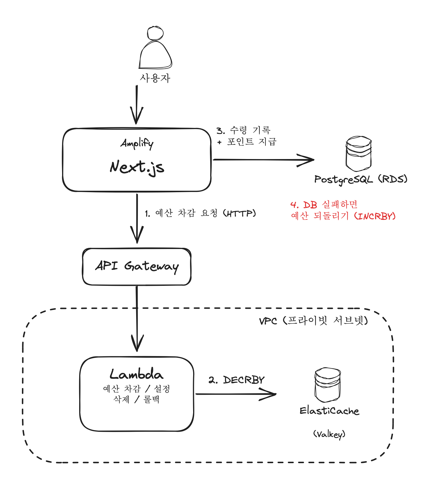

## 발단

<mark class="hltr-cyan">선착순 포인트 지급 이벤트</mark>를 만들게 됐다
화면과 API는 Next.js(Amplify)이고 DB는 PostgreSQL(RDS)인 구조였다

요구사항은 이랬다

- 전체 예산 안에서만 지급하고 다 떨어지면 지급 중지
- 같은 유저는 한번만 수령
- 요청이 한번에 몰려도 예산이 정확하게 차감될 것

마지막 조건때문에 구조를 세번이나 바꾸게 되었다

---

## 1차: DB 조건부 UPDATE

처음에는 Redis 없이 DB만으로 해결해보려고 했다
남은 예산이 충분할때만 차감하는 조건부 UPDATE를 쓰고 영향받은 행이 0이면 품절로 처리했다

```typescript
// 예시 코드
const updated = await tx.$executeRaw`
  UPDATE point_event
     SET remaining_budget = remaining_budget - ${amount}
   WHERE id = ${eventId}
     AND remaining_budget >= ${amount}`

if (updated === 0) throw new Error('SOLD_OUT')
```

UPDATE 한 문장은 원자적이라 예산이 마이너스가 되지는 않는다(정합성은 맞음)
문제는 락을 얼마나 오래 잡고 있느냐였다

### UPDATE가 잡은 행 락은 커밋할때까지 유지된다

UPDATE를 실행하면 그 행에 쓰기 락이 걸리는데 이 락은 문장이 끝날때가 아니라 <mark class="hltr-cyan">트랜잭션이 끝날때 풀린다</mark>
그런데 이 차감이 수령 기록 INSERT랑 포인트 지급과 같은 트랜잭션 안에 들어있었다

- 요청 A: 이벤트 행 락 획득 -> 수령 기록 -> 포인트 지급 -> 커밋하면서 락 해제
- 요청 B/C/D..: A가 커밋할때까지 같은 행 앞에서 대기

선착순은 시작하자마자 요청이 한꺼번에 들어오는데 그 요청들이 전부 이벤트 행 하나 앞에 줄을 서는 구조였던 것이다
트랜잭션이 길수록 대기도 길어지고 여러 테이블을 건드리다보니 데드락 여지도 생긴다

---

## 2차: 카운터만 Redis로 빼기

그래서 예산 차감만 DB 트랜잭션 밖으로 빼서 Redis에 맡기기로 했다

### 그럼 왜 Redis에서는 안 꼬일까?

Redis는 명령을 <mark class="hltr-cyan">한번에 하나씩 순서대로 실행</mark>한다
두 요청이 동시에 와도 `DECRBY` 두개가 차례로 실행될 뿐이라 중간에 끼어들 틈이 없다고 한다
그래서 읽고 -> 계산하고 -> 쓰는 과정을 애플리케이션에서 하지않고 `DECRBY` 한번에 맡기면 락 없이도 정확하게 깎인다

```typescript
// 예시 코드
export async function tryDecrementBudget(code: string, amount: number) {
  const key = `point_event:${code}:budget`

  const current = await redis.get<number>(key)
  if (current === null) return { success: false, reason: 'NOT_IN_REDIS' }

  const remain = await redis.decrby(key, amount)
  if (remain < 0) {
    await redis.incrby(key, amount) // 너무 깎은 만큼 되돌림
    return { success: false, reason: 'SOLD_OUT' }
  }
  return { success: true, remain }
}
```

일단 깎고 결과가 음수면 되돌리는 방식이다
예산이 100 남았을때 요청 두개가 동시에 와도 `DECRBY`는 순서대로 실행되니까 하나는 0이 되고 하나는 -100을 받아서 되돌리게 된다
그래서 초과 지급은 안된다

### DB가 실패하면 Redis도 되돌려야 한다

차감을 Redis로 빼면서 DB와 Redis가 하나의 트랜잭션으로 묶이지 않게 됐다
그래서 되돌리는 경로를 직접 만들어주었다

1. DB에서 이벤트 조회 + 이미 받은 유저인지 확인
2. Redis에서 예산 차감
3. DB에서 수령 기록 + 포인트 지급 (트랜잭션)
4. <mark class="hltr-cyan">3번이 실패하면 Redis 예산을 다시 늘린다</mark>

이제 DB 트랜잭션은 짧은 INSERT/UPDATE만 하니까 이벤트 행 하나에 줄 설 일이 없어졌다

그런데 같은 유저가 거의 동시에 두번 요청하면 1번 확인은 둘다 통과할 수 있다
그래서 수령 기록 테이블에 (이벤트 + 유저) 유니크 키를 걸어서 두번째 INSERT는 DB에서 막히게 해두었다

>[!GET/DECRBY/INCRBY는 한 덩어리가 아니다]
>
>위 코드는 명령 세개가 따로 나간다. `DECRBY` 하나는 원자적이라 초과 지급은 안되지만
>음수였다가 되돌리기 전 짧은 순간에는 다른 요청이 음수 값을 볼 수 있다(이 요청도 품절로 처리되니 결과는 맞음)
>세 단계를 진짜 한번에 묶고 싶으면 Lua 스크립트로 서버에서 한번에 실행하는 방법이 있다
>

```lua
-- 예시 코드 (대안: 확인과 차감을 한번에)
local remain = redis.call('GET', KEYS[1])
if not remain then return -2 end                 -- 이벤트 없음
if tonumber(remain) < tonumber(ARGV[1]) then
  return -1                                       -- 품절
end
return redis.call('DECRBY', KEYS[1], ARGV[1])
```

처음에는 셋업이 빠른 Upstash(HTTP로 호출하는 서버리스 Redis)로 만들었다
VPC 구성이 필요없어서 Amplify에서 바로 붙일 수 있었다

---

## 3차: ElastiCache로 옮긴 이유

잘 돌아가고 있었는데도 ElastiCache로 옮긴건 성능때문이라기보다 <mark class="hltr-cyan">인프라를 코드로 복제해야 했기때문</mark>이다

같은 구성을 여러번 따로 띄워야 하는 구조라서 외부 SaaS인 Upstash는 하나 늘어날때마다 콘솔에서 손으로 만들어줘야 했다
ElastiCache는 SAM(CloudFormation) 템플릿에 넣어두면 스택 이름만 바꿔서 `sam deploy` 한번으로 같은 구성을 찍어낼 수 있다

| 항목 | Upstash | ElastiCache |
|---|---|---|
| 프로토콜 | HTTP (REST) | TCP (Redis 프로토콜) |
| VPC | 필요 없음 | 필요 |
| 과금 | 요청당 | 시간당 |
| IaC | 어렵다 | SAM/CloudFormation |

---

## ElastiCache는 VPC 밖에서 못 붙는다

옮기면서 제일 크게 걸린건 네트워크였다
<mark class="hltr-cyan">ElastiCache는 VPC 안에서만 접근 가능</mark>한데 Amplify에서 도는 Next.js는 VPC 밖에 있다

그래서 중간에 다리를 하나 놔주었다

- Lambda를 VPC 프라이빗 서브넷에 두고 ElastiCache에 붙인다
- 그 Lambda를 API Gateway로 노출한다
- Next.js는 HTTP로 API Gateway를 호출한다



Lambda는 예산 차감/예산 설정/예산 삭제/롤백 네개로 나눴다

### VPC 안 Lambda는 인터넷이 안 된다

Lambda를 VPC에 넣으면 기본적으로 인터넷으로 나가는 길이 사라진다
외부 호출이 필요하면 NAT Gateway를 따로 둬야하는데 NAT는 시간당 과금이라 고정 비용이 생긴다
S3처럼 AWS 서비스만 쓰는 경우는 VPC 엔드포인트로 NAT 없이 붙을 수 있다고 한다

### ElastiCache Serverless에서 막힌 것들

```typescript
// 예시 코드
const redis = new Redis({
  host: process.env.CACHE_ENDPOINT,
  port: 6379,
  tls: {}, // Serverless는 TLS 필수
})
```

- TLS가 필수라서 클라이언트에 `tls` 옵션이 없으면 연결이 안 된다
- `KEYS` 명령이 막혀있어서 키를 볼때는 `SCAN`을 써야한다
- 로컬에서 직접 붙을 수가 없어서 디버깅할때는 VPC 안의 Bastion에 SSM으로 들어가서 redis-cli로 확인했다

---

## 로컬은 Upstash로 운영은 ElastiCache로

로컬/개발까지 ElastiCache를 쓰면 비용만 늘어나서 구현체를 환경변수로 고를 수 있게 했다

```typescript
// 예시 코드
import * as upstash from './upstash'
import * as elasticache from './pointEventApi' // API Gateway 호출

const useElastiCache = process.env.REDIS_PROVIDER === 'elasticache'

export const tryDecrementBudget = useElastiCache
  ? elasticache.tryDecrementBudget
  : upstash.tryDecrementBudget
```

호출하는 쪽은 어떤 Redis를 쓰는지 몰라도된다

---

몰리는 카운터는 Redis `DECRBY`로 트랜잭션 밖에서 깎는걸로 락 대기를 없앴고
NAT 비용은 조금 늘었지만 이제 템플릿 하나로 같은 구성을 계속 찍어낼 수 있게 됐다
